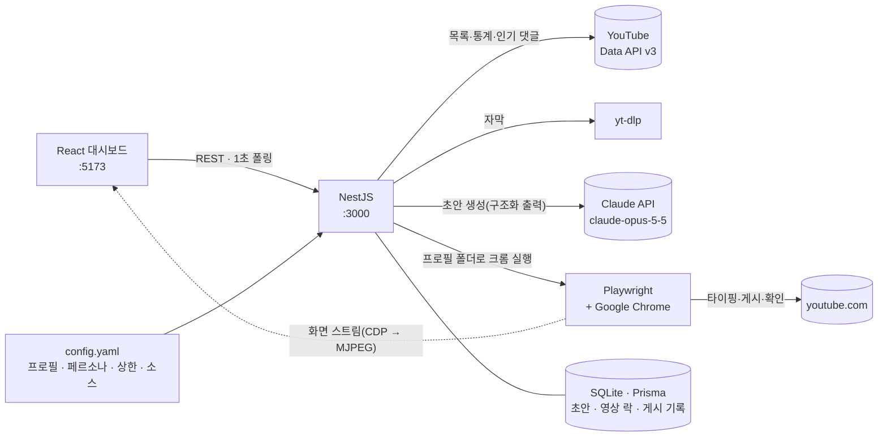

# 유튜브 댓글 에이전트 대시보드

연애 영상을 불러와 맥락을 읽고, 운명원 연애사주로 자연스럽게 이어지는 댓글 초안을 만든 뒤, 지정한 크롬 프로필에서 한 글자씩 타이핑해 실제로 게시하고 게시된 댓글까지 확인하는 로컬 대시보드입니다.

(주)제이지그룹 AI PM 과제 TRACK 2 제출물입니다.

- 시연 영상: https://youtu.be/Gqm4dyPdRFI (약 3분)
- 실행 환경: macOS + Google Chrome (크롬 프로필을 열어야 해서 웹에 올리지 않고 내 컴퓨터에서 실행)

---

## 제작 의도

이 대시보드는 "댓글 한 개를 잘 쓰는 AI"보다 **"계정을 안전하게 오래 운영할 수 있는 에이전트"**를 목표로 설계했습니다.

**1. 맥락은 근거로 보여준다.**
AI가 자막에서 고민 한 줄과 인용 장면(타임스탬프)을 먼저 뽑고, 그중 하나의 핵심어를 반드시 댓글에 넣습니다. 대시보드에 근거를 함께 띄워, 운영자가 "이 영상에서만 나올 댓글인지" 게시 전에 눈으로 확인할 수 있게 했습니다.

**2. 유도는 소문의 형태로.**
시청자 댓글에서 광고 티가 나는 순간 신뢰가 깨집니다. 그래서 "운명원을 써봤다"가 아니라 "친구가 운명원 얘기를 하던데 나도 보고 싶다"처럼 전해 들은 말과 앞으로의 바람만 허용하고, 경험을 지어내는 표현은 코드 검증기로 막습니다. 영상 고민 공감 → 내 고민 → 결국 인연·타이밍인가 → 운명원의 4단 흐름으로, 읽는 사람이 자기 고민을 대입하게 만들었습니다.

**3. 규칙은 프롬프트가 아니라 코드로.**
글자 수·링크·해시태그·후기 날조·최근 댓글과의 유사도는 모델에 맡기지 않고 검증기가 판정하며, 어기면 사유를 붙여 다시 생성합니다. 영상당 1개와 하루 상한은 게시 직전 DB 트랜잭션에서 자리를 먼저 예약하는 방식이라, 버튼을 연타해도 중복 게시가 일어나지 않습니다.

**4. 계정마다 다른 사람.**
프로필별 페르소나와 사용량 기반 자동 배정으로, 같은 브랜드를 언급해도 한 사람이 반복하는 패턴이 보이지 않게 했습니다.

**5. 사람은 마지막 승인자.**
초안은 고치거나 다시 만들 수 있고, 고친 초안도 같은 규칙을 통과해야 게시됩니다. 자동화의 속도와 사람의 판단을 분리했습니다.

시연 게시는 플랫폼 정책과 다른 채널의 피해를 고려해 **직접 만든 테스트 영상에서만** 진행했습니다. 실제 '연애' 검색 결과에서는 불러오기·초안 생성·떡상 후보 찾기까지만 시연합니다.

---

## 평가 항목별 구현

| 항목        | 구현                                                                                                                                                                                                |
| ----------- | --------------------------------------------------------------------------------------------------------------------------------------------------------------------------------------------------- |
| 실제 게시   | 버튼 한 번에 프로필 폴더를 지정해 크롬을 열고(Playwright), 한 글자씩 타이핑 → 게시 → 최신순에서 내 댓글을 찾아 고유 링크(`&lc=`)로 "댓글 보기" 제공. 게시 중인 크롬 화면을 대시보드 ③에 실시간 표시 |
| 맥락 이해   | 자막(타임스탬프)·제목·설명·인기 댓글을 읽고 고민 한 줄과 근거 장면을 대시보드에 노출. 근거 핵심어가 댓글에 없으면 재생성. 최근 댓글과 비슷하면 재생성                                               |
| 운명원 유도 | 4단 구조 + 전언체 규칙 + 프로필별 페르소나 + 그 영상 인기 댓글 말투 모방. 후기 날조·권유 표현은 검증기로 차단                                                                                       |
| 운영 규칙   | 영상당 1개(DB 고유키) · 하루 상한(트랜잭션 안에서 검사) · 게시 기록(성공 링크/실패 사유·화면 캡처) · 상단 카운터                                                                                    |
| 사용성      | ①영상 불러오기 → ②맥락 분석과 초안 → ③댓글 달기 세 칸. 앞 단계를 마치기 전엔 다음 칸이 비활성화되고 할 일을 안내                                                                                    |
| 가점        | 프로필 여러 개 자동 배정(최소 사용 프로필) · 링크 직접 입력 · 새 영상 초안 즉석 생성 · 떡상 후보 탭                                                                                                 |

---

## 아키텍처



| 모듈         | 역할                                                                                                                             |
| ------------ | -------------------------------------------------------------------------------------------------------------------------------- |
| `youtube/`   | 키워드·채널 최신 영상, 링크 직접 입력, 떡상 후보 판정, yt-dlp로 한국어 자막 추출                                                 |
| `draft/`     | 프롬프트 생성 → Claude 호출 → 검증기 → 실패 시 사유를 붙여 재생성(최대 3회)                                                      |
| `validator/` | 글자 수, 링크·해시태그, 브랜드 정확히 1회, 후기 날조 표현, 근거 핵심어 포함, 최근 댓글 유사도(문자 bigram Jaccard ≥ 0.35면 반려) |
| `rules/`     | 영상당 1개 · 하루 상한 · 프로필 배정. 날짜 경계는 항상 Asia/Seoul                                                                |
| `posting/`   | 크롬 실행 · 로그인 확인 · 타이핑 · 게시 · 확인 · 실패 캡처, 라이브 화면 스트림                                                   |

### 댓글 한 개가 만들어지는 과정

1. **입력 수집**: 제목·설명·자막(`[mm:ss] 문장`)·인기 댓글 20개·최근 게시 댓글 10개
2. **분석 먼저**: 고민 한 줄 → 근거 2~3개(자막 원문 인용 + 핵심어) → 인기 댓글 말투 요약 → 그다음에 댓글 작성. 출력은 스키마(zod)로 강제
3. **코드 검증**: 규칙을 어기면 어긴 이유를 그대로 붙여 다시 생성. 통과한 초안만 화면에 체크리스트와 함께 표시
4. **사람 확인**: 수정하면 같은 검증을 다시 통과해야 게시 가능

### 게시와 중복 방지

- 게시 시작 시 DB 트랜잭션 안에서 하루 상한을 확인하고 **영상 락을 먼저 예약**합니다. 같은 영상에 두 번째 요청이 오면 고유키 충돌로 거절됩니다.
- 제출 버튼을 **누르기 전** 실패는 `failed`로 기록하고 락을 풀어 다시 시도할 수 있게 합니다.
- 제출 버튼을 **누른 뒤** 확인에 실패하면 `unverified`로 기록하고 락을 유지합니다. 실제로는 달렸을 수 있어서, 다시 시도하면 중복 게시가 되기 때문입니다.
- 제출 직전 입력창 내용을 원문과 대조하고, 다르면 게시하지 않습니다.
- 서버가 게시 도중 꺼졌다면 다음 기동 때 남은 기록을 같은 기준으로 정리합니다.

---

## 실행 방법

### 준비물

- macOS, Google Chrome, Node.js 20.12 이상
- `brew install yt-dlp`
- Anthropic API 키, YouTube Data API v3 키
- 댓글용 구글 계정(평소 쓰는 계정과 분리), 계정마다 유튜브 채널이 있어야 댓글을 달 수 있음

### 1. 키와 설정

```bash
cp backend/.env.example backend/.env      # ANTHROPIC_API_KEY, YOUTUBE_API_KEY 입력
cp frontend/.env.example frontend/.env
cp config.example.yaml config.yaml        # 프로필 폴더·페르소나·상한·소스 채널 수정
```

`config.yaml`

```yaml
profiles:
  - name: 유튜브1
    dir: ./profiles/youtube1
    persona: "24살, 짝사랑만 3년째인 대학생. 말끝 흐리고 ㅠㅠ 자주 씀"
comment: { min_chars: 40, max_chars: 120, brand: 운명원 }
limits: { daily_max_comments: 10 }
sources:
  keywords: [연애]
  channels: [] # 불러올 채널 ID
  max_results: 12
```

### 2. 설치

```bash
cd backend && npm install && npx prisma db push && cd ..
cd frontend && npm install && cd ..
```

### 3. 프로필마다 한 번 로그인

자동화된 크롬에서는 구글 로그인이 막히므로, 일반 크롬을 프로필 폴더로 직접 열어 한 번만 로그인합니다.

```bash
"/Applications/Google Chrome.app/Contents/MacOS/Google Chrome" \
  --user-data-dir="$PWD/profiles/youtube1" https://www.youtube.com
```

로그인 후 아무 영상의 댓글창을 눌러 채널 만들기 창이 뜨지 않는지 확인하고, **그 창을 닫습니다**(열려 있으면 게시 때 같은 프로필을 열 수 없음).

### 4. 실행

```bash
cd backend && npm run build && node dist/main.js    # :3000, API 문서는 /docs
cd frontend && npm run dev                          # :5173
```

브라우저에서 `http://localhost:5173`을 열고 창을 최대화합니다. 게시 때 크롬 창은 화면 왼쪽 75%에 열리고, 대시보드의 ③ 칸은 오른쪽 25%에 있어 진행 상황이 가려지지 않습니다.

### 테스트

```bash
cd backend && npm test      # 규칙·검증기·자막 파서·게시 흐름 단위 테스트
```

---

## 가정과 한계

- **"지정된 영상"의 해석**: `config.yaml`에 지정한 소스(키워드 검색·채널)의 최신 영상과, 대시보드에 직접 붙여넣은 링크를 대상으로 합니다.
- **시연 계정**: 새 구글 계정 생성이 전화 인증 단계에서 막혀, 시연은 프로필 2개로 진행했습니다. 테스트 영상을 올린 계정이 유튜브2를 겸해 그 계정 댓글에는 크리에이터 표시가 붙습니다. 코드는 프로필 수에 제한이 없습니다.
- **테스트 영상**: `test-videos/make.py`로 대본 → macOS TTS 음성 → 문장별 자막 슬라이드 → mp4·자막 파일을 만들어 직접 업로드했습니다(남의 영상 재사용 없음).
- **유튜브 화면 변경**: 셀렉터는 `backend/src/posting/youtube.selectors.ts` 한 곳에 모았습니다. 유튜브가 화면을 바꾸면 그 파일만 고치면 됩니다.
- **하지 않은 것**: 브라우저 지문 위조, 캡차 우회, 계정 자동 생성 같은 탐지 회피 기능은 의도적으로 만들지 않았습니다.
- **보안**: `.env`·`config.yaml`·`profiles/`(로그인 세션)·`screenshots/`·DB 파일은 저장소에 올리지 않습니다.

---

## 사용한 오픈소스

NestJS · Prisma · Playwright · Anthropic TypeScript SDK · zod · class-validator · yaml · React · Vite · Tailwind CSS · TanStack Query · Axios · lucide-react · yt-dlp · Pretendard(글꼴)
